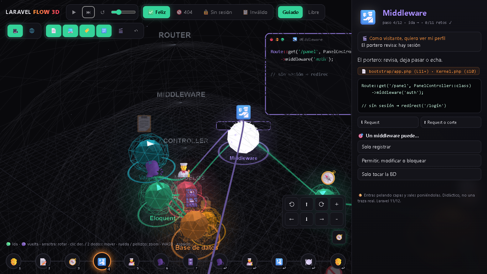
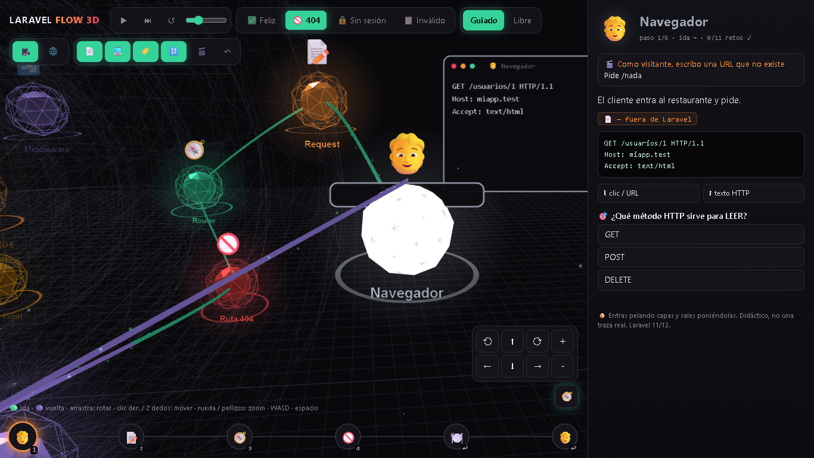
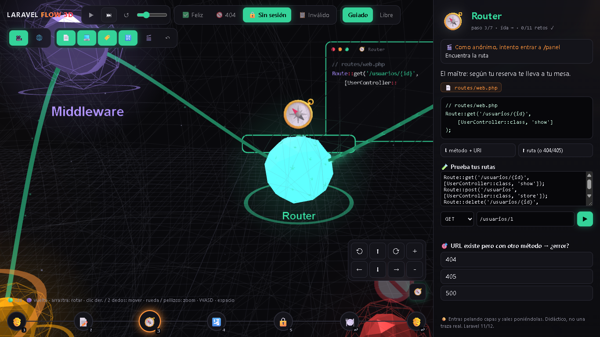
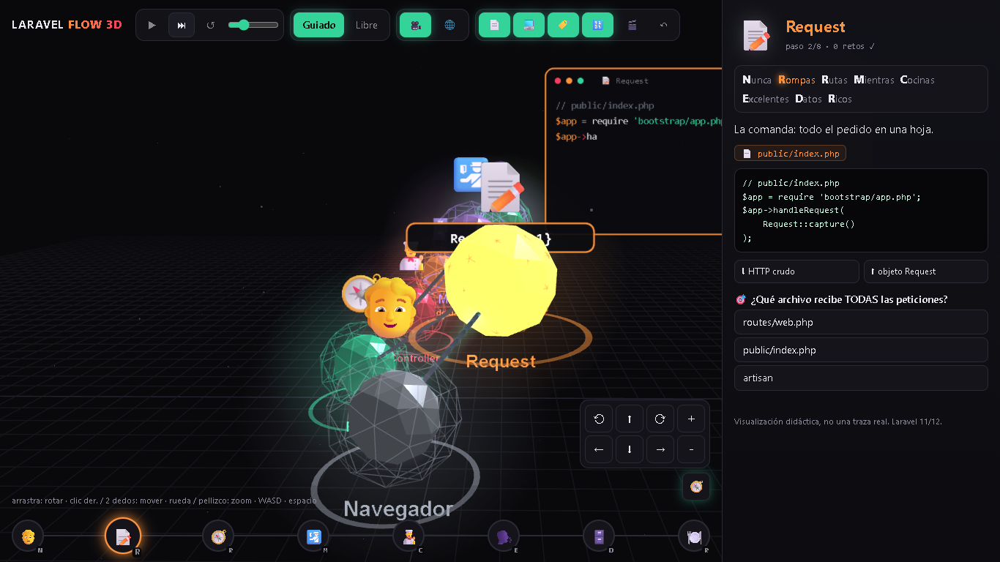
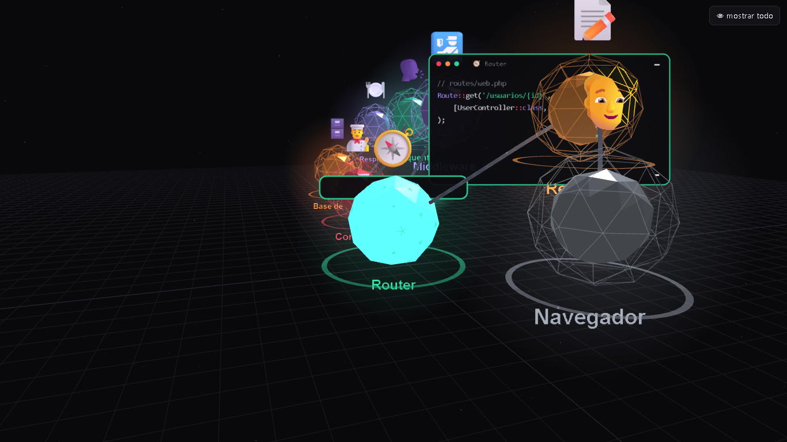

# 🧅 Laravel Flow 3D

**Visualización 3D interactiva del ciclo de vida de una petición HTTP en Laravel** — HTML puro, un solo archivo, sin servidor, sin internet (three.js r128 embebido).

[](https://marusan94.github.io/laravel-flow-3d/)
[](https://laravel.com)
[](https://threejs.org)
[](LICENSE)

[](https://marusan94.github.io/laravel-flow-3d/)

> Mira cómo `GET /usuarios/1` se convierte en partículas 3D cruzando capas: el **maître** (Router), el **portero** (Middleware), el **chef** (Controller) y la **despensa** (Eloquent / Base de datos). Con quiz por estación, código PHP real y cámara libre.

## 🎪 Demo en vivo

[🧅 Ver la cebolla](https://marusan94.github.io/laravel-flow-3d/) · [📏 Versión didáctica](https://marusan94.github.io/laravel-flow-3d/didactica.html)

No instala nada ni pide API keys: abre y navega (arrastra para rotar, rueda para zoom, **Espacio** para avanzar).

## 📸 Capturas de la app en vivo

| Vista | Captura |
|---|---|
| **Versión realista (cebolla)** — camino feliz, capas concéntricas de la petición |  |
| **Desvío 404** — URL fuera de la carta: el maître no la encuentra |  |
| **Desvío login** — sin sesión, el portero frena en `/panel` y te manda a `/login` (302) |  |
| **Versión didáctica** — línea recta con estaciones N→R→M→C→E→D→B y quiz de estilo entrevista |  |
| **Modo cine** — vista limpia solo-escenario para presentar |  |

📸 Capturadas con Playwright (1366×768) desde el demo en vivo: <https://marusan94.github.io/laravel-flow-3d/>

## 🧅 vs 📏 Dos versiones del mismo mapa

| Versión | Archivo | Cómo se ve | Para qué |
|---|---|---|---|
| **Realista (cebolla)** | [`index.html`](https://marusan94.github.io/laravel-flow-3d/) | Esferas concéntricas: la petición entra en espiral hacia el núcleo (Modelos/BD) y sale de vuelta. Capas = responsabilidades | Entender **dónde** ocurre realmente cada paso, incluidos los desvíos que cortan el flujo |
| **Didáctica (línea recta)** | [`didactica.html`](https://marusan94.github.io/laravel-flow-3d/didactica.html) | Estaciones en orden sobre una línea: N(vegador) → Router → Request, Middleware, Controller, Eloquent, DB, Blade, con ida y vuelta sobre un solo camino | Ver la **secuencia** sin ruido, con quiz de estilo entrevista |

Ambas tienen: 🎮 **modo guiado** (historias con preguntas por nodo) · 🆓 **modo libre** (explora cada estación) · 💻 tarjetas de **código PHP real** con máquina de escribir · 🧪 **sandbox** "Prueba tus rutas" (elige método + URL y mira la respuesta) · 🎥 cámara libre (arrastrar/zoom/pan/WASD) · 🎬 modo cine · 📱 controles táctiles · ⌨️ atajos: `Espacio` avanzar, `←/→` paso, `P/C` paneles, `Z` deshacer, `R` restaurar.

## 🗂️ Historias disponibles (versión realista)

| # | Historia | Qué muestra |
|---|---|---|
| 1 | ✅ Camino feliz | `GET /usuarios/1`: todo el ciclo ida y vuelta con SQL y respuesta HTML |
| 2 | 🚫 404 | URL que no existe: el maître no la encuentra, va al Manejador de Excepciones |
| 3 | 🔒 Sin sesión | `GET /panel` anónimo: el portero frena el flujo → `302 /login` (el controlador nunca corre) |
| 4 | 📼 Formulario inválido | `POST /usuarios` sin email: validación guarda errores en sesión y redirige atrás |

## ⚡ Quickstart

```bash
git clone https://github.com/Marusan94/laravel-flow-3d.git
# doble clic a index.html — eso es todo
```

o simplemente [ábrelo en el navegador](https://marusan94.github.io/laravel-flow-3d/). Sin `npm install`, sin API keys — three.js va embebido en el HTML: funciona sin internet (avión, oficina, hackathon con WiFi dudoso).

## 🚩 Qué es y qué no es

Es una demo didáctica: quería *ver* el flujo de una petición Laravel de forma bonita, no construir un framework. Todo el lío experimental cabe en un HTML autónomo de ~640 KB. Si buscas el proyecto en serio con backend, mapas y copiloto RAG: [🌎 Terramind](https://github.com/Marusan94/Terramind).

## 🛠️ Nota técnica

| Capa | Qué usa |
|---|---|
| Motor 3D | three.js r128 (MIT) incrustado — `TubeGeometry` para el río de partículas, esferas wireframe para capas |
| Escenas | Sprite atlas generado con canvas 2D (etiquetas, tarjetas de código, quizzes) |
| Contenido | Escrito a mano: rutas de `routes/web.php`, middleware de `bootstrap/app.php`, estilo Eloquent de `app/Models` |

## 📜 Licencia

MIT — haz lo que quieras con él. Ver [`LICENSE`](LICENSE).

---

🧅 *Entra pelando capas* · 🍽️ *El restaurante Laravel en tu navegador* · Built in Medellín, Colombia — @Marusan94

> ⚠️ Aviso: visualización didáctica, no una traza real de Laravel 11/12.
